<!--
  super-seo: a code-first SEO + GEO skill for Claude Code. Audits a SaaS codebase and its running site
  (localhost, preview or production), then ships the fixes as code.
-->

<p align="center">
  
</p>

<h1 align="center">super-seo</h1>

<p align="center">
  <a href="#-quick-start">
    
  </a>
</p>

<p align="center">
  <b>The SEO + GEO engineer that lives inside <a href="https://claude.com/product/claude-code">Claude Code</a>.</b><br />
  Rank in Google, get cited by AI search, and keep it that way on every release.
</p>

<p align="center">
  <a href="#-features">Features</a> ·
  <a href="#-how-it-works">How it works</a> ·
  <a href="#-quick-start">Quick start</a> ·
  <a href="#-just-ask-claude">Usage</a> ·
  <a href="#-the-toolkit">Toolkit</a> ·
  <a href="#-admin-integrations">Admin integrations</a> ·
  <a href="#-framework-support">Frameworks</a> ·
  <a href="#-faq">FAQ</a>
</p>

<p align="center">
  
  
  
  <a href="https://github.com/digitalscapemy/super-seo/stargazers"></a>
  
</p>

---

Most SEO tools look at a live URL and hand you a list of problems. **super-seo starts where your product is built: the code.**
It reads your framework, routes and metadata, crawls a production build on `localhost` before you deploy, checks whether
Google **and** AI engines can actually reach and read your pages, then writes the fix in your framework's own APIs:
metadata, canonicals, sitemaps, robots rules, JSON-LD, server rendering and the pages buyers search for.

Built for SaaS teams who ship weekly and want search visibility to be part of the build, not an afterthought.

## ✨ Features

<table>
<tr>
<td width="33%" valign="top">

### 🧠 Code-aware audits
Detects Next.js, Vite, Laravel, Astro, Nuxt, SvelteKit, Remix and more. Finds routes without metadata, `noindex`
left on, `localhost` or preview URLs in canonicals, client-only JSON-LD and SPA shells that bots see as empty.

</td>
<td width="33%" valign="top">

### 🕷️ Localhost-first crawler
Audits your production build **before** deploy: status codes, redirects, canonicals, sitemap, robots, titles, Open
Graph, structured data, hreflang, duplicates, orphans, broken links, WAF blocks.

</td>
<td width="33%" valign="top">

### 🤖 AI search access
Checks every major AI crawler (search, user-triggered and training) against robots.txt using RFC 9309 rules, probes
for CDN/WAF blocks, and detects managed robots.txt blocks you never wrote.

</td>
</tr>
<tr>
<td valign="top">

### 🛠️ Fixes shipped as code
Drop-in templates for metadata, sitemaps, environment-aware robots rules, `llms.txt` and a full SaaS JSON-LD
graph, wired the way each framework expects.

</td>
<td valign="top">

### 📈 AI visibility tracking
Measures how often ChatGPT, Perplexity, Gemini, AI Overviews, Claude and Copilot **mention** and **cite** you
versus competitors, which sources they lean on, and how that moves over time.

</td>
<td valign="top">

### ✍️ Citable content
Section-by-section checks for answer-first writing, self-contained passages, sourced numbers, comparison tables and
stock phrasing, on a URL or straight from your `.mdx` files.

</td>
</tr>
<tr>
<td valign="top">

### 🧭 SaaS page playbook
Specs for pricing, feature, use-case, integration, `vs` and alternatives pages, docs and changelog, plus quality gates
for programmatic pages.

</td>
<td valign="top">

### 🔌 Admin integrations
Production-ready patterns to bring Search Console, GA4, Bing Webmaster, IndexNow and Core Web Vitals into your
super-admin backend.

</td>
<td valign="top">

### 🛡️ Release gate
One command scores readiness and fails CI on criticals; drift detection catches `noindex`, canonical or H1
regressions between releases.

</td>
</tr>
</table>

## 🔁 How it works

<p align="center">
  
</p>

1. **Scan code**: framework, rendering mode, route metadata and leaks, straight from the repository.
2. **Crawl localhost**: a production build is audited like a search engine would see it, before anyone else does.
3. **Check AI access**: robots rules per crawler, CDN and WAF behaviour, text visible without JavaScript.
4. **Fix in code**: Claude applies the matching framework recipe and re-runs the audit until no critical issue remains.
5. **Gate releases**: the same checks run in CI, and drift detection compares every release with the last.

## 🎬 See it in action

<p align="center">
  
</p>

The audit writes a Markdown and a self-contained HTML report to `.seo/reports/`, plus raw JSON for every check.

## 🚀 Quick start

**Requirements:** [Claude Code](https://claude.com/product/claude-code) and Python 3.10 or newer.

**1. Install the skill**

```bash
# macOS / Linux
git clone https://github.com/digitalscapemy/super-seo.git ~/.claude/skills/super-seo
```

```powershell
# Windows (PowerShell)
git clone https://github.com/digitalscapemy/super-seo.git "$env:USERPROFILE\.claude\skills\super-seo"
```

Using a custom `CLAUDE_CONFIG_DIR`? Clone anywhere and run `install.ps1`, which copies the skill to the right place.
To update later, run `git pull` in the skill folder.

**2. Open any SaaS project in Claude Code and ask:**

```text
Audit the SEO of this project
```

**3. Or run the audit yourself**

```bash
npm run build && npm run start          # any production build on localhost
python ~/.claude/skills/super-seo/scripts/audit.py --path . --url http://localhost:3000
```

## 💬 Just ask Claude

The skill activates on its own whenever you talk about search visibility. A few examples:

| You say | super-seo does |
|---|---|
| *"Audit the SEO of this project"* | Code scan + localhost crawl + AI access check → scorecard, top fixes, backlog |
| *"Make this Next.js app SEO-ready"* | Adds metadata, canonicals, sitemap, robots rules, JSON-LD and `llms.txt` in code |
| *"Build a pricing page that ranks"* | Researches the query, writes answer-first copy, adds plan schema |
| *"Write a comparison page against our main competitor"* | Honest, sourced comparison with tables, dates and disclosure |
| *"Why doesn't ChatGPT mention us?"* | Checks bot access, sets up prompt tracking, maps the gaps to actions |
| *"Integrate Search Console into the admin panel"* | OAuth or service account, daily sync, opportunities dashboard |
| *"Get us ready to launch"* | Pre-launch gate, Search Console and Bing setup, baseline crawl |
| *"Did the last release break anything?"* | Re-crawls and diffs against the previous release |

## 🧰 The toolkit

Every script runs on the Python standard library, on Windows, macOS and Linux. Claude runs them for you; you can also
run them directly or in CI.

| Script | What it does |
|---|---|
| `audit.py` | Runs everything below and produces the readiness scorecard plus Markdown/HTML reports; CI exit codes |
| `project_scan.py` | Static scan of the codebase: framework, rendering mode, routes without metadata, leaks, missing SEO files |
| `crawl_audit.py` | Crawler for localhost, preview or live sites, with 70+ checks across pages and the whole site |
| `ai_access.py` | robots.txt per AI crawler, WAF/CDN probes, Content-Signal, snippet controls, `llms.txt`, Markdown negotiation |
| `content_check.py` | Citability signals per section for a URL or a local `.md`/`.mdx`/`.html` file |
| `ai_visibility.py` | Scores collected AI answers: mention rate, citation rate, position, gaps, cited sources, trends |
| `gsc_report.py` | Search Console exports → striking-distance queries, low CTR, cannibalisation, question queries |
| `drift.py` | Compares two crawls and flags SEO regressions between releases |
| `robots_rfc.py` | RFC 9309 robots.txt matcher (longest match, group selection, wildcards) |

<details>
<summary><b>Command reference</b></summary>

```bash
python scripts/audit.py --path . --url http://localhost:3000 --fail-on critical
python scripts/audit.py --url https://example.com --psi            # adds PageSpeed / CrUX field data
python scripts/project_scan.py .
python scripts/crawl_audit.py https://example.com --max-pages 100 --out .seo/audits
python scripts/ai_access.py https://example.com --paths pricing docs
python scripts/content_check.py content/blog/post.mdx
python scripts/ai_visibility.py checklist .seo/ai-visibility
python scripts/ai_visibility.py score .seo/ai-visibility/runs/2026-11-19
python scripts/gsc_report.py .seo/gsc --brand "acme"
python scripts/drift.py --latest .seo/audits --fail-on critical
```

For reliable Core Web Vitals data, set `PSI_API_KEY` to a PageSpeed Insights API key from the Google Cloud console.

</details>

## 🧩 Workflows

| | Workflow | Outcome |
|---|---|---|
| **A** | Full audit | Verdict, top 1–3 fixes, scorecard and a prioritised backlog |
| **B** | Implement in code | Framework-native fixes, verified by a re-crawl |
| **C** | Write or optimise a page | Researched, answer-first page with metadata and schema |
| **D** | GEO / AI visibility | Access fixes, prompt tracker, mention and citation gaps turned into actions |
| **E** | Research | Keywords, clusters, competitors and link prospects from first-party and web evidence |
| **F** | Launch & release gate | Launch checklist, Search Console / Bing setup, CI gate, drift checks |
| **G** | Quick answers | Short, sourced answers from the built-in references |
| **H** | Admin integrations | Search Console, GA4, Bing, IndexNow and CWV inside your product's backend |

## 🔌 Admin integrations

Bring first-party search data into your SaaS super-admin backend, with templates for **Laravel** and **Next.js**.

| Integration | What your admin gets |
|---|---|
| **Google Search Console** | OAuth 2.0 with PKCE per tenant, or a service account for the platform; 16-month backfill and daily sync; sitemap status; URL Inspection for key pages |
| **Google Analytics 4** | Organic landing pages, conversions, and traffic referred by AI assistants |
| **Bing Webmaster Tools** | Query stats from the index behind Copilot and part of ChatGPT search |
| **IndexNow** | Instant change notifications to Bing, Yandex, Naver and Seznam on publish and update |
| **PageSpeed Insights / CrUX** | p75 LCP, INP and CLS field data, with lab fallback |

The dashboard pattern focuses on action: striking-distance queries, titles losing clicks for their position, pages split
across one query, indexing problems, Core Web Vitals and alerts. Tokens are encrypted at rest, every query is
tenant-scoped, and a tenant can only attach a property that matches its own verified domain.

## 🏗️ Framework support

| Stack | What super-seo sets up |
|---|---|
| **Next.js App Router** | `metadataBase`, per-route `generateMetadata`, `sitemap.ts`, environment-aware `robots.ts`, OG images, `llms.txt` route, server-rendered JSON-LD |
| **Next.js Pages Router** | `next/head` per page, data in `getStaticProps`, sitemap generation |
| **Vite / React / Vue SPA** | Marketing-site split or build-time prerendering, per-route head, real 404s |
| **Laravel (Blade / Inertia)** | Layout metadata, Inertia SSR, sitemap package, environment-aware robots, `noindex` middleware for app routes |
| **Astro** | Site config, sitemap integration, layout head, JSON-LD, `llms.txt` endpoint |
| **Nuxt · SvelteKit · Remix · React Router 7 · TanStack Start** | Native head/meta APIs, prerendering, resource routes for sitemap and robots |
| **Static HTML + nginx** | Per-page head, correct 404 handling, staging `noindex`, cache headers |

## 🤖 AI crawler policy, done right

super-seo keeps three kinds of access separate, because they control different things:

| Access | Examples | Controls |
|---|---|---|
| **Search / index** | Googlebot, bingbot, OAI-SearchBot, Claude-SearchBot, PerplexityBot | Whether you can be found and cited in answers |
| **User-triggered** | ChatGPT-User, Claude-User, Perplexity-User | Whether an assistant can open your page when a user asks |
| **Training** | GPTBot, ClaudeBot, Google-Extended, Applebot-Extended, CCBot | Whether content is used to train models (your business decision) |

## 🗂️ Project memory

Each project keeps its SEO context and history next to the code, so every session starts informed:

```text
.seo/
├── project.md          # positioning, audience, competitors, key pages, crawler policy
├── research-log.md     # one line per research task, reused for 30 days
├── audits/             # raw JSON + Markdown from every check (drift compares these)
├── reports/            # human-readable audit reports (.md + .html)
├── ai-visibility/      # tracker, collected answers per run, scores and trends
└── gsc/                # Search Console exports
```

## 🛡️ CI release gate

Fail the build when a release would hurt search visibility:

```bash
python tools/seo/crawl_audit.py "$PREVIEW_URL" --max-pages 80 --out .seo/audits --fail-on critical
python tools/seo/drift.py --latest .seo/audits --fail-on critical
```

A hardened GitHub Actions workflow is included in `templates/github/seo-gate.yml`: read-only token, tools run from
the default branch, deployed code read as data only.

## 📐 Principles

- **Evidence before advice.** Every finding comes from a file that was read, a page that was fetched or a script that ran.
- **Fixes, not reports.** The deliverable is a diff plus a short report.
- **One system for Google and AI.** Crawlable, server-rendered, well-ranked, clearly written pages win in both.
- **Honest claims.** No ranking, traffic or citation forecasts; heuristics are labelled as heuristics.
- **Safe by default.** Network guards against private-address redirects, decompression limits, hardened CI.

## 📁 Repository layout

```text
super-seo/
├── SKILL.md            # how Claude routes each request to a workflow
├── references/         # technical SEO, GEO, schema, SaaS pages, integrations, research, reporting
├── scripts/            # the toolkit
├── templates/          # Next.js, Laravel, JSON-LD, robots.txt, project memory, CI workflow
├── assets/             # README artwork
└── install.ps1         # copies the skill into your Claude Code skills folder
```

## ❓ FAQ

<details>
<summary><b>Does it work on a site that isn't deployed yet?</b></summary>

Yes, and that's the point. Run a production build locally (`next build && next start`, `vite build && vite preview`,
`php artisan serve`) and audit `http://localhost:<port>`. Development servers behave differently, so audit a production build.
</details>

<details>
<summary><b>Is GEO different from SEO?</b></summary>

Mostly it's SEO done properly, plus three things: letting AI crawlers in (robots rules, CDN and WAF settings), making
content readable without JavaScript, and writing passages that can be quoted on their own. Off-site presence on the
sources AI engines cite matters too, and super-seo shows you which ones those are.
</details>

<details>
<summary><b>How is AI visibility measured?</b></summary>

You collect real answers from each engine for a fixed set of buyer prompts (super-seo prints the checklist), and the
scorer computes mention rate, citation rate, position and competitor gaps. Simulated, search-grounded answers can be
used to find likely gaps, and they are always reported separately from real observations.
</details>

<details>
<summary><b>Will it change my code without asking?</b></summary>

It proposes and applies fixes through Claude Code, so every edit goes through your normal Claude Code permissions and
shows up as a reviewable diff.
</details>

<details>
<summary><b>Do I need an `llms.txt`?</b></summary>

It's cheap and useful for documentation and developer products, because coding agents read it. It isn't a ranking
factor, so super-seo gives it zero weight in the score.
</details>

<details>
<summary><b>Which languages and markets does it support?</b></summary>

Any. Reports follow the language you write in, page copy follows the target market, and hreflang, currencies and local
search terms are handled per market.
</details>

## 🤝 Contributing

Issues and pull requests are welcome. Please include the framework, the command you ran and the relevant part of the
report when reporting a problem.

---

<p align="center">
  <sub>Built by <a href="https://github.com/digitalscapemy">Digitalscape</a> · Made for teams who ship SaaS and want to be found.</sub><br />
  <a href="#super-seo"><sub>Back to top ↑</sub></a>
</p>
