<!--
  super-seo: a code-first, multi-agent SEO + GEO skill for Claude Code. Audits a codebase and its running site
  (localhost, preview or production), then ships the fixes as code.
-->

<p align="center">
  
</p>

<h1 align="center">super-seo</h1>

<p align="center">
  <a href="#-quick-start">
    
  </a>
</p>

<p align="center">
  <b>The SEO + GEO superhero squad that lives inside <a href="https://claude.com/product/claude-code">Claude Code</a>.</b><br />
  Type <code>/super-seo</code>. Eight specialists audit your codebase and your site in parallel, then fix what they find.
</p>

<p align="center">
  <a href="#-meet-the-squad">Squad</a> ·
  <a href="#-features">Features</a> ·
  <a href="#-how-it-works">How it works</a> ·
  <a href="#-quick-start">Quick start</a> ·
  <a href="#-commands">Commands</a> ·
  <a href="#-extensions">Extensions</a> ·
  <a href="#-the-toolkit">Toolkit</a> ·
  <a href="#-admin-integrations">Admin</a> ·
  <a href="#-framework-support">Stacks</a> ·
  <a href="#-faq">FAQ</a>
</p>

<p align="center">
  
  
  
  
  
  <a href="https://github.com/digitalscapemy/super-seo/stargazers"></a>
</p>

---

Most SEO tools look at a live URL and hand you a list of problems. **super-seo starts where your product is built: the code.**
It reads your framework, routes and metadata, crawls a production build on `localhost` before you deploy, checks whether
Google **and** AI engines can actually reach and read your pages, then writes the fix in your framework's own APIs.

## 🦸 Meet the squad

<p align="center">
  
</p>

| Hero | Agent | Power |
|---|---|---|
| **CODE** | `super-seo-code` | Reads routes, metadata, sitemap and robots code, JSON-LD components and leaks; generates verified robots, sitemap and `llms.txt` |
| **TECHNICAL** | `super-seo-technical` | Crawl and index health, redirects, canonicals, hreflang, TLS and headers, drift between releases, update-correlated traffic drops |
| **GEO** | `super-seo-geo` | AI crawler access, WAF and CDN blocks, `llms.txt`, citability, Wikidata entity checks, AI-answer gaps |
| **CONTENT** | `super-seo-content` | Page inventory, on-page quality, metadata rewrites, internal links, programmatic-page gates, search-experience fit |
| **SCHEMA** | `super-seo-schema` | Validates JSON-LD everywhere and writes ready-to-paste markup per page type |
| **SPEED** | `super-seo-performance` | Core Web Vitals, Lighthouse, raw-vs-rendered HTML, desktop and mobile screenshots, images, performance hints |
| **RIVALS** | `super-seo-competitors` | Verified competitors, SERP clusters, comparison-page opportunities, link prospects, backlink and domain checks |
| **FIXER** | `super-seo-fixer` | Applies fixes in parallel, one instance per file set, then verifies with a re-scan |

## ✨ Features

<table>
<tr>
<td width="33%" valign="top">

### 🧠 Code-aware audits
Detects Next.js, Vite, Laravel, Astro, Nuxt, SvelteKit, Remix and more. Finds routes without metadata, `noindex`
left on, `localhost` or preview URLs in canonicals, client-only JSON-LD and SPA shells that bots see as empty.

</td>
<td width="33%" valign="top">

### 🕷️ Localhost-first crawler
Audits your production build **before** deploy with 70+ checks: status codes, redirects, canonicals, sitemap, robots,
titles, Open Graph, structured data, hreflang, duplicates, orphans, broken links and WAF blocks.

</td>
<td width="33%" valign="top">

### 🤖 AI search access
Checks every major AI crawler (search, user-triggered and training) with RFC 9309 rules, probes for CDN/WAF blocks,
and detects managed robots.txt blocks you never wrote.

</td>
</tr>
<tr>
<td valign="top">

### 🖥️ Real browser rendering
Compares raw HTML with the rendered DOM to catch content only JavaScript can see, captures desktop and true 390 px
mobile screenshots, and checks agent-friendly UI.

</td>
<td valign="top">

### 📈 AI visibility tracking
Measures how often ChatGPT, Perplexity, Gemini, AI Overviews, Claude and Copilot **mention** and **cite** you
versus competitors, which sources they lean on, and how that moves over time.

</td>
<td valign="top">

### ⚡ Performance, measured
Core Web Vitals field data, CrUX history and LCP subparts, Lighthouse on any URL including localhost, image weight
and format, render-blocking and bfcache hints.

</td>
</tr>
<tr>
<td valign="top">

### 🛠️ Fixes shipped as code
Drop-in templates and generators for metadata, sitemaps, policy-verified robots rules, `llms.txt` and a full SaaS
JSON-LD graph; a hook validates JSON-LD every time a file is edited.

</td>
<td valign="top">

### 🧭 Every page type
Playbooks for SaaS pages, e-commerce, local businesses, multilingual sites, content briefs, topic clusters and 90-day
strategy roadmaps per business type.

</td>
<td valign="top">

### 🛡️ Release gate
A readiness score that fails CI on criticals, drift detection between releases, readiness history over time, and a
live Google update timeline to explain traffic changes.

</td>
</tr>
</table>

## 🔁 How it works

<p align="center">
  
</p>

1. **Scan** the code: framework, rendering mode, route metadata and leaks.
2. **Crawl** a production build on localhost, the way a search engine sees it.
3. **Unblock** AI bots: robots rules per crawler, CDN and WAF behaviour, text visible without JavaScript.
4. **Fix** in code: specialists propose, fixers apply in parallel, the audit re-runs until no critical issue remains.
5. **Guard** releases: the same checks in CI, with drift detection against the previous release.

## 🎬 See it in action

<p align="center">
  
</p>

Every run writes Markdown, HTML and (optionally) PDF reports to `.seo/reports/`, plus raw JSON for every check.

## 🚀 Quick start

<p align="center">
  
</p>

**Requirements:** [Claude Code](https://claude.com/product/claude-code) and Python 3.10 or newer. Node.js and a
Chromium-based browser unlock the Lighthouse and browser extensions.

**macOS / Linux**

```bash
git clone https://github.com/digitalscapemy/super-seo.git
cd super-seo && ./install.sh                 # add --enable-hook for JSON-LD validation on every edit
```

**Windows (PowerShell)**

```powershell
git clone https://github.com/digitalscapemy/super-seo.git
cd super-seo; .\install.ps1                  # add -EnableHook for JSON-LD validation on every edit
```

The installer copies the skill, its extensions and the eight `super-seo-*` agents into your Claude Code folder
(respecting `CLAUDE_CONFIG_DIR`). Re-run it after `git pull` to update. Check everything with
`python scripts/doctor.py --online`.

**Then open any project in Claude Code and type:**

```text
/super-seo
```

<p align="center"></p>

## 🎮 Commands

| Command | What happens |
|---|---|
| `/super-seo` | **Full audit + improvement**: baseline → squad in parallel → verified, prioritised report → safe fixes applied, content changes confirmed → re-audit with before/after |
| `/super-seo audit` | The full audit without changing code |
| `/super-seo fix` | Implement the latest report's backlog, then verify |
| `/super-seo geo` | AI-search access, citability and AI-answer gaps |
| `/super-seo page <path or url>` | Write or optimise one page |
| `/super-seo plan` | A 90-day roadmap for your business type, built from the latest audit |
| `/super-seo launch` | Pre-launch gate and launch-day setup |
| `/super-seo integrations` | Build SEO integrations into your super-admin backend |
| `/super-seo extensions` | Show which extensions are active and how to enable the rest |
| `/super-seo doctor` | Check the installation and environment |
| `/super-seo quick <url>` | A fast baseline audit, summarised in chat |

You can also just talk to it: *"Why doesn't ChatGPT mention us?"*, *"Make this Next.js app SEO-ready"*,
*"Write a comparison page against our main competitor"*, *"Did the last release break anything?"*,
*"Is this domain safe to buy?"*

## 🔌 Extensions

<p align="center">
  
</p>

Extensions switch on automatically when their requirement is present. Run `python scripts/extensions.py` to see the
status on your machine.

| Extension | Adds | Enable with |
|---|---|---|
| **Google** | Search Console queries, pages, URL Inspection, sitemaps; GA4 organic and AI referrals; PageSpeed; CrUX and history; LCP subparts | OAuth desktop login, a service account, or a PageSpeed API key |
| **Bing Webmaster** | Query and page stats, inbound link counts, crawl issues, URL submission | Bing Webmaster API key |
| **IndexNow** | Key generation and verification, change submission | an IndexNow key |
| **PostHog · Matomo · Umami** | Organic and AI-assistant referral traffic, landing pages | each tool's API key |
| **Cloudflare** | Bot and AI-crawler traffic and block rates, managed robots detection | a Cloudflare API token |
| **Lighthouse** | Lighthouse on any URL including localhost, Agentic Browsing results, site-wide runs | Node.js (`npx`) |
| **Browser** | Raw vs rendered HTML diff, desktop and mobile screenshots, agent-UX and mobile checks | an installed Chrome, Edge or Chromium |
| **Shopify** | Product and collection SEO gaps, redirect chains | a store Admin API token |
| **YouTube** | Brand mentions in videos, channel stats, video SEO | a YouTube Data API key |

<p align="center"></p>

## 🧰 The toolkit

Every script runs on the Python standard library. Claude runs them for you; you can also run them directly or in CI.

| Area | Scripts |
|---|---|
| **Audit & gate** | `audit.py` (scorecard, Markdown/HTML/PDF reports, CI exit codes) · `drift.py` (release regressions, readiness history) · `doctor.py` |
| **Code & crawl** | `project_scan.py` (codebase) · `crawl_audit.py` (70+ checks, localhost OK) · `hreflang_check.py` · `transport_check.py` (TLS, redirects, headers) |
| **AI search** | `ai_access.py` (crawler policy, WAF probes, llms.txt) · `ai_visibility.py` (mention and citation tracking) · `entity_check.py` (Wikidata/Wikipedia) |
| **Content** | `content_check.py` (citability) · `programmatic_check.py` (scaled-page gates) · `text_clean.py` (hidden Unicode) |
| **Performance** | `image_audit.py` · `hints_check.py` (render-blocking, preload, bfcache) |
| **Generators** | `sitemap_gen.py` · `robots_gen.py` (RFC 9309 self-verified) · `llms_gen.py` |
| **Research & history** | `gsc_report.py` (striking distance, CTR, cannibalisation) · `google_updates.py` (live update timeline) · `backlink_verify.py` · `domain_history.py` · `local_check.py` (NAP, LocalBusiness) |

<details>
<summary><b>Command reference</b></summary>

```bash
python scripts/audit.py --path . --url http://localhost:3000 --fail-on critical --pdf
python scripts/crawl_audit.py https://example.com --max-pages 100 --out .seo/audits
python scripts/ai_access.py https://example.com --paths pricing docs
python scripts/robots_gen.py --domain example.com --training block --format nextjs
python scripts/llms_gen.py --url https://example.com --max-pages 60
python scripts/programmatic_check.py --sitemap https://example.com/sitemap.xml --pattern /integrations/
python scripts/google_updates.py correlate --gsc .seo/gsc
python scripts/drift.py --history .seo/audits
python extensions/google/google.py gsc --property sc-domain:example.com --days 90
python extensions/lighthouse/lighthouse.py run http://localhost:3000 --agentic
python extensions/browser/render_check.py render http://localhost:3000/pricing
```

</details>

<p align="center"></p>

## 🔌 Admin integrations

Bring first-party search data into your SaaS super-admin backend, with templates for **Laravel** and **Next.js**:
Search Console (OAuth 2.0 with PKCE per tenant, or a service account for the platform), GA4 organic and AI-referral
traffic, Bing Webmaster, IndexNow and Core Web Vitals. Tokens are encrypted at rest, OAuth state is signed, every
query is tenant-scoped, and a tenant can only attach a property that matches its own verified domain.

## 🏗️ Framework support

<p align="center">
  
</p>

| Stack | What super-seo sets up |
|---|---|
| **Next.js App Router** | `metadataBase`, per-route `generateMetadata`, `sitemap.ts`, environment-aware `robots.ts`, OG images, `llms.txt` route, server-rendered JSON-LD |
| **Next.js Pages Router** | `next/head` per page, data in `getStaticProps`, sitemap generation |
| **Vite / React / Vue SPA** | Marketing-site split or build-time prerendering, per-route head, real 404s |
| **Laravel (Blade / Inertia)** | Layout metadata, Inertia SSR, sitemap package, environment-aware robots, `noindex` middleware for app routes |
| **Astro** | Site config, sitemap integration, layout head, JSON-LD, `llms.txt` endpoint |
| **Nuxt · SvelteKit · Remix · React Router 7 · TanStack Start** | Native head/meta APIs, prerendering, resource routes for sitemap and robots |
| **Shopify · static HTML + nginx** | Store SEO gaps and redirects; per-page head, 404 handling, staging `noindex` |

<p align="center"></p>

## 🗂️ Project memory

```text
.seo/
├── project.md          # positioning, audience, competitors, key pages, crawler policy
├── research-log.md     # one line per research task, reused for 30 days
├── audits/             # raw JSON from every check and every agent (drift and history read these)
├── reports/            # human-readable reports (.md, .html, .pdf)
├── screenshots/        # desktop and mobile captures from the browser extension
├── ai-visibility/      # tracker, collected answers per run, scores and trends
└── gsc/                # Search Console exports
```

<p align="center"></p>

## 📐 Principles

- **Evidence before advice.** Every finding comes from a file that was read, a page that was fetched or a script that ran.
- **Fixes, not reports.** The deliverable is a diff plus a short report.
- **One system for Google and AI.** Crawlable, server-rendered, well-ranked, clearly written pages win in both.
- **Honest claims.** No ranking, traffic or citation forecasts; heuristics are labelled as heuristics.
- **Safe by default.** Every fetch and every browser connection goes through a private-network guard; decompression
  limits, signed OAuth state and a hardened CI template come built in.

<p align="center"></p>

## ❓ FAQ

<details>
<summary><b>Does it work on a site that isn't deployed yet?</b></summary>

Yes, and that's the point. Run a production build locally and audit `http://localhost:<port>`. Development servers
behave differently, so audit a production build.
</details>

<details>
<summary><b>Do I need all the extensions?</b></summary>

No. The core works on its own. Each extension adds a data source and turns on automatically when its key or tool is present.
</details>

<details>
<summary><b>Will it change my code without asking?</b></summary>

`/super-seo` applies safe, mechanical fixes (metadata, sitemap, robots, schema with confirmed facts) and asks before
content or business changes. Every edit goes through your normal Claude Code permissions as a reviewable diff, and
nothing is committed for you.
</details>

<details>
<summary><b>How is AI visibility measured?</b></summary>

You collect real answers from each engine for a fixed set of buyer prompts (super-seo prints the checklist), and the
scorer computes mention rate, citation rate, position and competitor gaps. Simulated, search-grounded answers are
reported separately from real observations.
</details>

<details>
<summary><b>My traffic dropped. Can it tell me why?</b></summary>

It lines your Search Console data up against the live Google update timeline, checks drift between your releases, and
re-audits indexing and access. A date overlap is treated as a hypothesis to test, never as proof.
</details>

<details>
<summary><b>Which languages and markets does it support?</b></summary>

Any. Reports follow the language you write in, page copy follows the target market, and hreflang, currencies and local
search terms are handled per market.
</details>

## 🤝 Contributing

Issues and pull requests are welcome. Run `python -m unittest discover -s tests` before opening a PR, and include the
framework, the command you ran and the relevant part of the report when reporting a problem.

<p align="center">
  
</p>

<p align="center">
  <sub>Built by <a href="https://github.com/digitalscapemy">Digitalscape</a> · Made for teams who ship and want to be found.</sub><br />
  <a href="#super-seo"><sub>Back to top ↑</sub></a>
</p>
